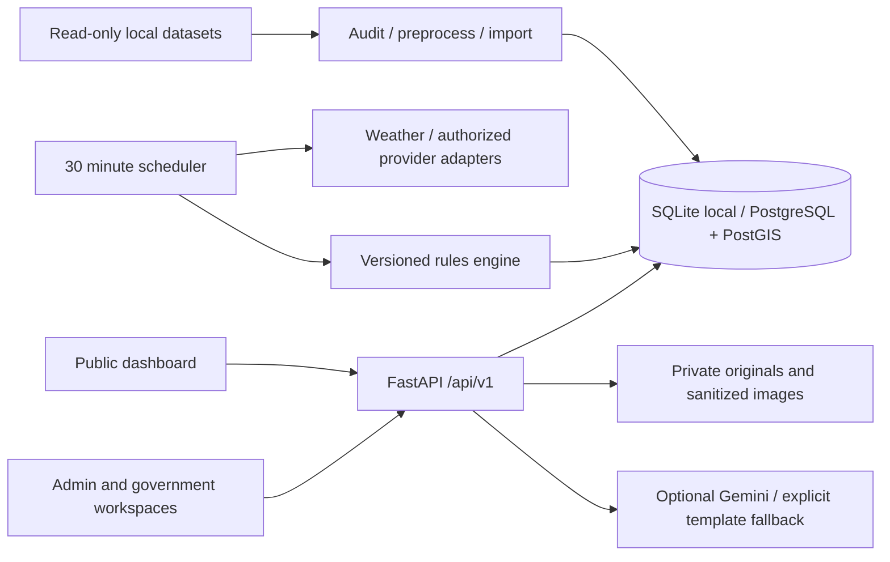

# Architecture

The existing application remains Next.js App Router, React 19, TypeScript, Tailwind, React Leaflet and Recharts. Its light teal theme and regional explorer are extended with lake profiles and staff operations. FastAPI/Pydantic validates the versioned API; OpenAPI lives at `/docs`.

`db.py` owns schema migrations and transactions. Version 1 creates operational tables; PostgreSQL version 2 adds PostGIS lake/admin-region geometry and GIST indexes. JSON assessment documents retain the ten components, thresholds, version, source mode and missingness. Tables deliberately consolidate role assignments and jurisdiction IDs on users, alert geographic scope on its incident region, and evidence metadata on private reports rather than prematurely creating every suggested entity.

Local SQLite provides durable offline development without Docker. Compose uses PostgreSQL/PostGIS, a backend, scheduler and frontend. PostGIS migration execution requires an extension-capable database role; use a separate restricted runtime role when deploying. Geometry columns mirror retained GeoJSON; no upstream polygon is simplified or silently repaired. Boundary files are served locally and imported to PostGIS when available.

Compose also defines an opt-in `backend-tests` service under the `test` profile. Its `TEST_POSTGRES=1` fixture creates a random test schema and sets that connection's search path to the schema plus public PostGIS functions. Migrations, raw rate-limiter SQL, imports, authentication and report/alert tests run against PostgreSQL without resetting application tables. Schema cleanup is limited to that internally generated test namespace.

Reports transition from Submitted to Escalated or Rejected; officials may request field verification, reject, or verify and create a Confirmed incident. Approval is separate from publication. Administrators cannot confirm incidents or approve alerts. Jurisdiction checks are performed on every official mutation, evidence access, export and list, independently of UI visibility. In this small MVP a single assigned official can draft and approve; two-person separation requires additional staffing policy and is not enforced.

Access tokens are opaque, random, hashed in storage and expire in 15 minutes. Refresh tokens rotate, expire in eight hours and live only in HttpOnly SameSite=Strict cookies. Browser access tokens remain in memory. Sessions are revoked when account access changes. Cross-origin frontend/API deployments require deliberate cookie/domain configuration; use the same site behind a TLS reverse proxy.

Scheduler runs are idempotent with respect to assessment facts and lifecycle transitions. The scheduler expires alerts, marks stale sources and cleans expired sessions/rate limits. Each invocation records synchronization history. Notification adapters currently record mock email/SMS deliveries at publication; they do not contact recipients. A production queue needs transactional outbox delivery, retries and dead-letter handling.

Provider contracts expose name, mode, observation time, synchronization time, freshness, health, error and attribution. Only Open-Meteo has a live weather adapter. DHM, terrain, population-exposure, satellite-water, rainfall and infrastructure are explicit unavailable adapters until authorized data and methods are configured. Raster auditing does not constitute flood-exposure modelling.

Municipality search, geodesic evacuation modelling, a verified resource directory, real identity verification, production notifications and satellite ingestion remain provider/data integration work. Report jurisdictions are selected from the supported districts and location checks enforce geographic bounds; coordinates are not certified against legal administrative jurisdictions. Officials must review that association. No secret or dataset access restriction is bypassed.

## Contextual evidence integration

`context_data.py` reproducibly prepares the broader ICIMOD inventory and latest historical GLOF revision into atomic, ignored local derivatives. `context_api.py` serves bounded searches and district WorldPop summaries independently of the assessed dangerous-lake database. District population uses verified per-cell counts, NoData masking, bounded raster windows and source-keyed caches. `district_weather.py` supplies current forecasts at representative district locations; the provider coalesces identical requests, bounds concurrency, persists provenance and reuses only valid current-day caches. `EvidenceExplorer` is shared by the dashboard, `/evidence` and staff monitoring; the notice composer links to the incident district. None of these contextual associations establishes an upstream cause or inundation footprint. See `docs/integration-status.md`.
